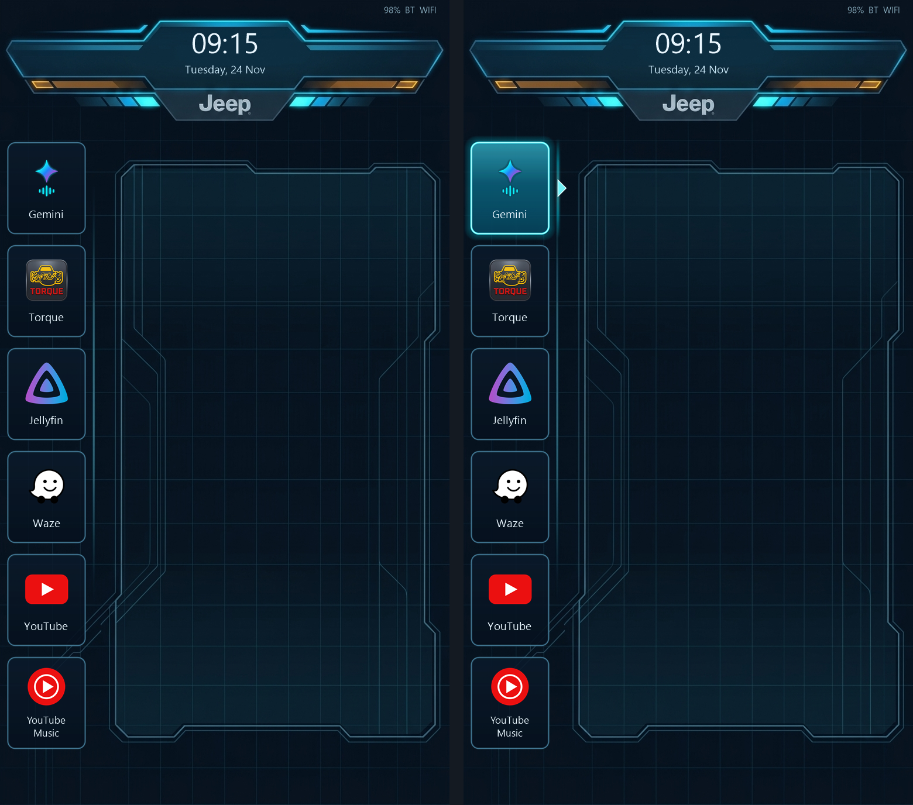

# Jeep HUD KLWP Dashboard

An installable Android APK for portrait Jeep Android head units (e.g., UNISOC UIS7865 Tesla-style stereos) that bundles a custom **KLWP Live Wallpaper** preset together with **Floating Apps / Freeform windowed app launching**, **Gemini Voice Conversation**, and **automatic Audio Glow Music Visualizer launching** whenever YouTube Music opens.

## Features

1. **Custom Jeep Cyber HUD KLWP Preset (`Jeep_HUD_Dashboard.klwp`)**
   - Bottom climate control panel cleanly removed so your Jeep stereo's native HVAC bar sits cleanly underneath.
   - Live real-time **Clock** (`12h`/`24h` toggleable in KLWP Globals), **Date**, and top-right **Battery / Bluetooth / Wi-Fi** readout.
   - All **6 interactive sidebar buttons** with dynamic glowing cyan active highlight & right-pointing rail chevron (no stuck Waze highlight):
     1. **Gemini** *(above Torque)* — opens Gemini Voice Conversation (`ACTION_VOICE_COMMAND` / `ACTION_ASSIST` / Gemini app)
     2. **Torque** — opens Torque Pro / Lite in a floating window
     3. **Jellyfin** — opens Jellyfin in a floating window
     4. **Waze** — opens Waze in a floating window
     5. **YouTube** — opens YouTube in a floating window
     6. **YouTube Music** — opens YouTube Music in a floating window **and** automatically opens **Audio Glow Music Visualizer**
   - Tap the top **Clock / Jeep HUD header** anytime to open the Jeep HUD Companion settings.
   - Tap empty space inside the right HUD window frame to clear the active button highlight.

2. **Floating Apps (`com.lwi.android.flapps`) & Android Freeform Integration**
   - Supports **one-tap shortcut linking** directly through Floating Apps' native `QLFAShortcut` picker (`Link FA` button for each app).
   - Also works out-of-the-box with **Android Freeform Mode** (`ActivityOptions.setLaunchBounds` + `WINDOWING_MODE_FREEFORM`), calibrated to open apps cleanly inside the right-hand cyan HUD window frame.
   - Built-in **HUD Frame Bounds Calibrator** sliders so you can fine-tune the exact window rectangle for your stereo's resolution.

3. **YouTube Music → Audio Glow Automation**
   - Tapping **YouTube Music** opens YouTube Music in the upper portion of the HUD frame and automatically opens **Audio Glow Music Visualizer** (`com.cyphercove.audioglowfs`) in the lower portion (or full HUD frame, configurable).
   - Includes an optional lightweight **Background Monitor (`AccessibilityService`)** so Audio Glow automatically launches whenever YouTube Music is opened from *anywhere* on the stereo (voice command, Floating Apps menu, or steering wheel controls).

## Installation & Stereo Setup

1. Install **KLWP Live Wallpaper Maker** (Pro recommended for loading APK packs, or use the built-in **Export `.klwp`** button), **Floating Apps (multitasking)** by LWi s.r.o., **Audio Glow Music Visualizer** by Cypher Cove, **Google Gemini**, **Torque**, **Jellyfin**, **Waze**, **YouTube**, and **YouTube Music**.
2. Install **`Jeep-HUD-KLWP-Dashboard-v1.0.0.apk`** from the [Releases](../../releases) page.
3. Open **Jeep HUD KLWP** on your Jeep stereo:
   - Tap **LOAD DASHBOARD IN KLWP** (then tap the Save icon in KLWP and set KLWP as your home screen live wallpaper).
   - Enable Freeform Mode inside **Floating Apps** and **Developer Options → Enable freeform windows / Force activities to be resizable**.
   - *(Optional)* Tap **Link FA** beside any app to bind a native Floating Apps shortcut directly.
   - Tap **Enable Background YouTube Music Monitor** in Accessibility Settings so Audio Glow always launches whenever YouTube Music opens.
   - Set **Google Gemini** as your stereo's **Default Digital Assistant** so the Gemini button starts voice conversation immediately.

## Project Structure

- `app/src/main/java/org/kustom/api/` — Kustom `ContentProvider` (`org.kustom.provider.WALLPAPERS`)
- `app/src/main/java/com/jeep/klwpdash/launcher/` — Floating Apps / Freeform window launcher + 6 exported KLWP trampoline activities
- `app/src/main/java/com/jeep/klwpdash/service/` — `YouTubeMusicMonitorService` for automatic Audio Glow launching
- `app/src/main/assets/wallpapers/Jeep_HUD_Dashboard.klwp` — Bundled KLWP live wallpaper preset
- `klwp-preset/` — Source `preset.json`, transparent HUD icons, glow cards, and thumbnails
- `scripts/` — Asset and `.klwp` preset build scripts
- `.github/workflows/build-apk.yml` — Automated signed APK build & GitHub Release workflow
